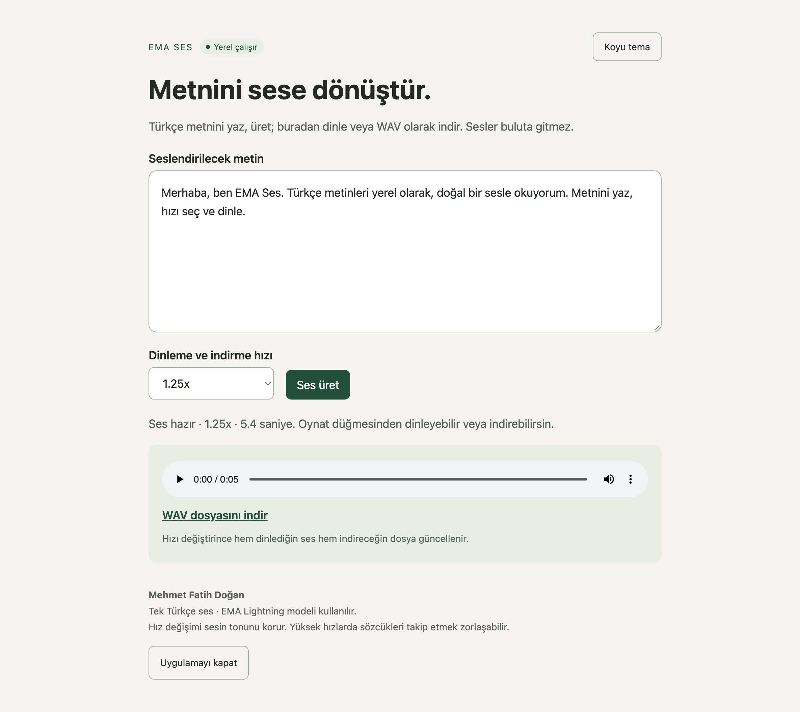

# EMA Ses

**Türkçe metni bilgisayarında sese dönüştür.** Tarayıcıda 0.5×–7× hızda dinle, seçtiğin hızda WAV indir. Ses üretimi cihazında yapılır. Hesap veya API anahtarı gerekmez.

<picture>
  <source media="(prefers-color-scheme: light)" srcset="docs/ekran-acik.png">
  
</picture>

## İndir ve çalıştır

[GitHub Releases](https://github.com/fatihdogann/ema-ses/releases) sayfasından işletim sistemine uygun ZIP'i indir ve tamamını bir klasöre çıkar.

| Sistem | Paket | Açılacak dosya |
| --- | --- | --- |
| macOS 14 ve üzeri · Apple Silicon (M serisi) | `EMA-Ses-macOS-arm64.zip` | **EMA Ses.app** |
| Windows · x64 (Intel veya AMD) | `EMA-Ses-Windows-x64.zip` | **Baslat.bat** |

Mac'te **EMA Ses.app** dosyasını istersen **Uygulamalar** klasörüne taşı. Windows'ta çıkardığın **EMA Ses** klasöründeki dosyaları birlikte tut.

İlk açılışta başlatıcı Python'u, ses işleme bağımlılıklarını ve modeli indirir. Kurulum tamamlanınca varsayılan tarayıcıda `http://127.0.0.1:7868` açılır. Sonraki açılışlarda internet gerekmez. İlk kurulumun ilerlemesini açılan komut penceresinde görebilirsin.

macOS paketi Apple tarafından noter onayından geçirilmemiştir. macOS açılışı engellerse, paketi bu deponun Releases sayfasından indirdiğini doğrula ve [Apple'ın açma adımlarını](https://support.apple.com/guide/mac-help/open-a-mac-app-from-an-unidentified-developer-mh40616/mac) izle.

## Kullanım

1. Türkçe metni yaz ve **Ses üret** düğmesine bas.
2. Oynatıcıdan dinle. Hızı sonradan değiştirdiğinde model metni yeniden seslendirmez.
3. **WAV dosyasını indir** ile seçili hızdaki sesi kaydet.
4. İşin bittiğinde **Uygulamayı kapat** düğmesine bas. Tarayıcı sekmesini kapatmak yerel sunucuyu durdurmaz.

Uygulama 17 hız seçeneği, sistem temasını izleyen açık ve koyu görünüm ve tek bir Türkçe ses sunar. Tek istekte en fazla 10.000 karakter kabul eder. Metin ve ses üretim için bir sunucuya gönderilmez.

WAV kopyaları ve `uygulama.log`, Windows paketinde ve kaynak kurulumunda uygulama klasöründe tutulur. Mac paketinde bu dosyalar `~/Library/Application Support/EMA Ses/` altındadır. WAV kopyalarını ilgili klasörün `sesler/` dizininde bulabilirsin.

## Kaynak koddan çalıştır

[uv](https://docs.astral.sh/uv/getting-started/installation/) kur. Ardından depoyu klonla veya GitHub'dan kaynak kod ZIP'ini çıkar.

```sh
git clone https://github.com/fatihdogann/ema-ses.git
cd ema-ses
uv run --locked python launch.py
```

Aynı komut iki platformda da çalışır. `Baslat.command` (macOS) veya `Baslat.bat` (Windows) ile de başlatabilirsin. Bağımlılık sürümleri `uv.lock` ile sabitlenir.

Uygulama açıkken şu komutla Türkçe ses üretimini, 17 hızın WAV sürelerini ve indirme yanıtlarını denetleyebilirsin.

```sh
uv run --locked python kontrol.py
```

## Açılış sorunları

- **Tarayıcı açılmadıysa** komut penceresindeki mesajı kontrol et. `EMA Ses hazır` yazıyorsa `http://127.0.0.1:7868` adresini elle aç.
- **İlk indirme yarıda kaldıysa** internet bağlantısını kontrol edip başlatıcıyı yeniden aç. Model ve kurulum dosyaları önbellekte yeniden kullanılır.
- **Ses üretimi veya açılış başarısızsa** yukarıdaki konumda `uygulama.log` dosyasını kontrol et. Hata bildirirken işletim sistemini ve hata satırını ekle.

Kendi özel ağındaki başka bir cihazdan erişmek için [Tailscale Serve](https://tailscale.com/docs/features/tailscale-serve) ile `127.0.0.1:7868` adresini paylaşabilirsin. Uygulamanın çalıştığı bilgisayar açık ve erişilebilir olmalıdır.

## Model ve lisans

EMA Ses, **Canberk Aslan** tarafından geliştirilen [EMA Lightning](https://github.com/canberk7/ema-lightning) modelini CPU üzerinde çalıştırır. Model ağırlıkları ilk açılışta [Hugging Face](https://huggingface.co/canberkkkkkk/ema-lightning) üzerinden indirilir. Perdeyi koruyarak hız değiştirmek için FFmpeg'in [`atempo` filtresi](https://ffmpeg.org/ffmpeg-filters.html#atempo) kullanılır.

Bu deponun kodu [MIT](LICENSE) lisanslıdır. EMA Lightning kodu ve model ağırlıkları Apache 2.0 lisanslıdır.

## İletişim

**Mehmet Fatih Doğan** · [Portfolyo ve iletişim](https://mehmetfatihdogan.com.tr/iletisim) · [GitHub](https://github.com/fatihdogann)
